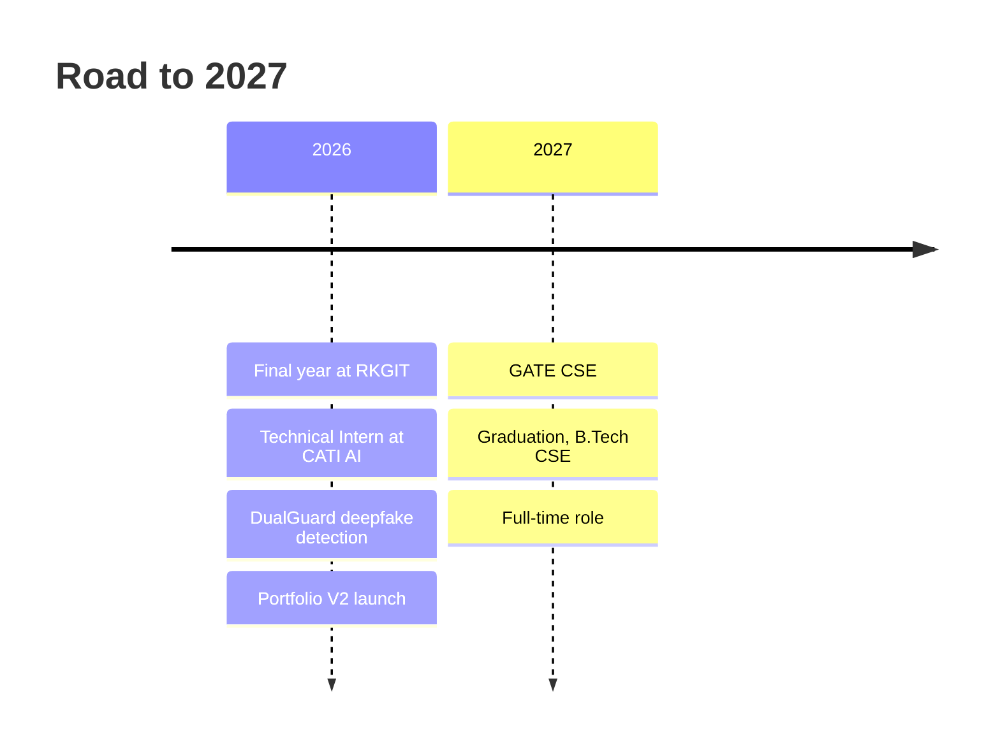
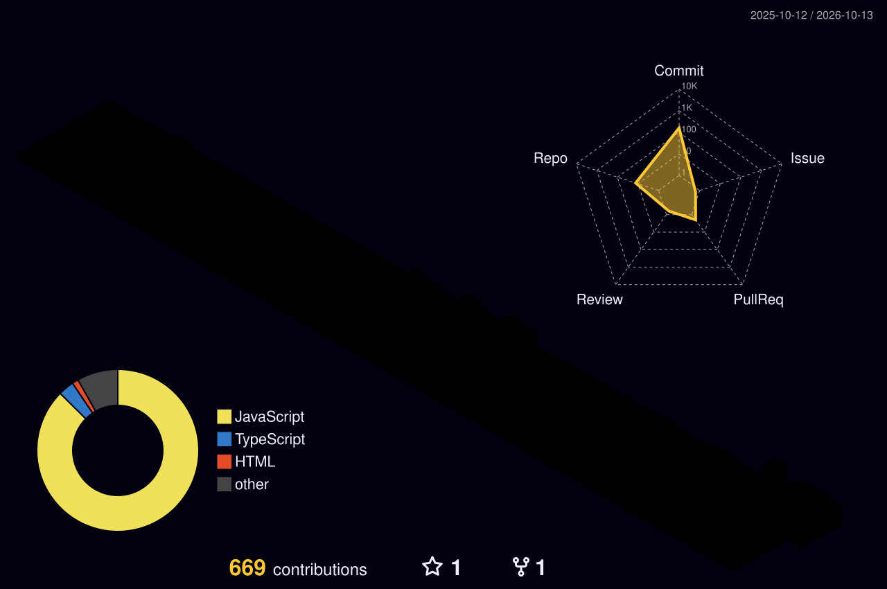

<div align="center">



<a href="https://iamshivansh.in">
  
</a>

<br/><br/>


<br/><br/>

<a href="https://iamshivansh.in"></a>
<a href="https://linkedin.com/in/gupta-shivansh"></a>
<a href="mailto:shivanshgupta.sde@gmail.com"></a>
<a href="https://github.com/Shivansh-04"></a>

</div>


## 🗡️ `About Me`

<table>
<tr>
<td width="50%" valign="top">

```yaml
name:        Shivansh Gupta
role:        Full-Stack Developer (MERN)
education:   B.Tech CSE @ RKGIT, Ghaziabad
cgpa:        7.8
graduating:  2027
location:    Delhi NCR, India
currently:
  - Technical Intern @ CATI AI
  - Final-year project: DualGuard
  - GATE CSE 2027 prep
learning:    [React Native, Korean]
motto:       "Code is my jutsu."
```

</td>
<td width="50%" valign="top">

> *"I build things, break things, and ship things, mostly in that order."*

I'm a **MERN stack developer** and **competitive programmer** who loves turning ideas into real products, from **voice-AI integrations** and **deepfake detection** to **fintech engines** and **manga-styled web experiences**.

I thrive where **clean code meets great UX**.

💬 Ask me about **Java · C++ · Python · JavaScript · React · Node.js**

</td>
</tr>
</table>

---

## 🎯 `Current Status`

<div align="center">

| 🔭 BUILDING | 💼 WORKING | 🌱 LEARNING | 🎯 PREPARING |
|:---:|:---:|:---:|:---:|
| **Portfolio V2**<br/>manga-style SPA | **CATI AI**<br/>voice AI platform | **React Native**<br/>& **Korean** | **GATE CSE 2027**<br/>& daily **DSA** |

</div>

---

## 🧭 `Journey`



---

## 🧰 `Tech Stack`

<div align="center">

<table>
<tr>
<td align="center" width="25%"><b>🎨 Frontend</b></td>
<td align="center" width="25%"><b>⚙️ Backend</b></td>
<td align="center" width="25%"><b>💻 Languages</b></td>
<td align="center" width="25%"><b>🧠 AI & Tools</b></td>
</tr>
<tr>
<td align="center"></td>
<td align="center"></td>
<td align="center"></td>
<td align="center"></td>
</tr>
</table>


</div>

---

## 🚀 `Featured Projects`

<div align="center">

<table>
<tr>
<td width="50%" valign="top">

### 🛡️ DualGuard


CNN-based **deepfake detection** that separates real media from manipulated media. Covers dataset prep, model training and evaluation, built as a team project.

`Python` `TensorFlow` `CNN` `Deep Learning`

</td>
<td width="50%" valign="top">

### 📈 Options Pricing Engine
 [**Open Demo →**](https://options-engine.onrender.com)

Full-stack **fintech app** that prices options contracts instantly through a clean parameter-and-results interface.

`React` `Node.js` `Render`

</td>
</tr>
<tr>
<td width="50%" valign="top">

### 🎌 Manga Portfolio V2
 [**iamshivansh.in →**](https://iamshivansh.in)

Manga-style **single page app** with a spatial-canvas redesign, smooth animations and a storytelling layout.

`React` `Vite` `Tailwind` `Framer Motion`

</td>
<td width="50%" valign="top">

### 📊 Algorithm Visualizer


**Step-by-step** visualization of sorting algorithms with animations that make every comparison and swap easy to follow.

`React` `Framer Motion`

</td>
</tr>
<tr>
<td width="50%" valign="top">

### 🛰️ SatQuery AI


**Agentic remote-sensing system** for visual question answering and change detection on optical and SAR satellite imagery, inspired by an ISRO problem statement.

`Python` `Agentic AI` `Remote Sensing`

</td>
<td colspan="2" valign="top">

### ☁️ Image Upload & Storage Microservice


Lightweight service for **uploading, storing and serving images** through Cloudinary, built to plug into any web app. `Node.js` `Express` `Cloudinary`

</td>
</tr>
</table>

</div>

---

## 💼 `Experience`

<table>
<tr>
<td width="50%" valign="top">

### 🧑‍💻 Technical Intern · CATI AI
<sub>Remote · Gurgaon</sub>

- Building integrations for a **voice AI agent** platform
- **Cal.com** booking tool-calling: availability, booking, listing bookings
- **Browser microphone capture** for the Test Agent (React + backend)

</td>
<td width="50%" valign="top">

### 🏛️ Intern · NPTI
<sub>National Power Training Institute</sub>

- QA and bug-checking of a government institute website
- Documentation and reporting work

</td>
</tr>
</table>

---

## 🏆 `Achievements & Activities`

<div align="center">

| 🥊 SIH | ⚡ Binary Hacks 2.0 | 📜 Certified | 🌐 Active On |
|:---:|:---:|:---:|:---:|
| Smart India Hackathon<br/>**Participant** | **Participant** | Coursera &<br/>Apna College | LeetCode · CodeChef<br/>GFG · HackerRank |

</div>

- 📘 Wrote **user manuals** and **role-based testing guides** for admin panels
- ⚔️ Daily **DSA** practice alongside **GATE 2027** prep

---

## 📊 `GitHub Analytics`

<div align="center">


<br/>


<br/>

### 🏙️ 3D Contribution City




### 🐍 Contribution Snake


</div>

---

## 🔗 `Connect`

<div align="center">

<a href="https://linkedin.com/in/gupta-shivansh"></a>
<a href="https://twitter.com/shivansh__04"></a>
<a href="https://instagram.com/iamshivansh.dev"></a>
<a href="https://iamshivansh.in"></a>
<a href="mailto:shivanshgupta.sde@gmail.com"></a>

<br/><br/>

<em>⚡ "Every expert was once a beginner. Every pro was once an amateur." ⚡</em>


</div>
